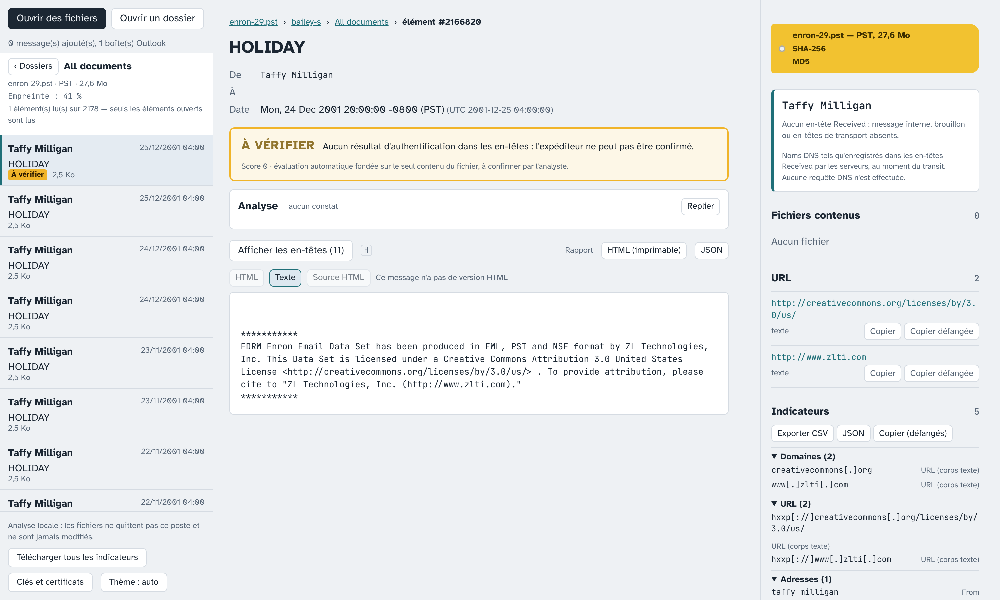
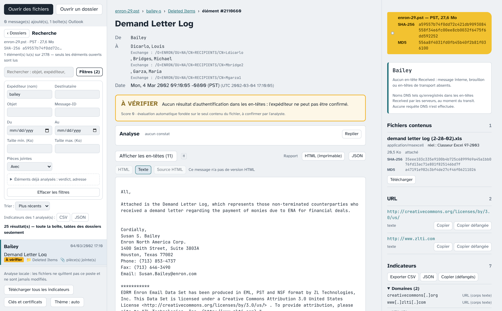

# Email Analysis

**Drop in a suspicious email. One second later: a verdict, the evidence behind it, and everything you need to act.**

Email Analysis is a forensic investigation tool for **`.eml`** and **`.msg`** (Outlook) files,
and for whole Outlook mailboxes (**`.pst`** / **`.ost`**).
It reads a message the way an analyst would — where it really came from, who signed it, where its
links lead, what its attachments hide — and presents it in a clear interface, a printable report
and ready-to-block indicators.

Everything happens **on your machine**. No file is uploaded, no request is made, and the evidence
is never modified.


> **Try it now**: the web version runs entirely in your browser —
> [tranosgames.github.io/email_analysis](https://tranosgames.github.io/email_analysis/).
> Files you drop there never leave your computer.
>
> The interface is currently in French.

---

## What it sees for you

### A verdict, and why

Every message gets a verdict — **Malicious**, **Needs review** or **Legitimate** — shown at the top
and as a badge in the list, with the reasons behind it. The verdict is cautious by design:

- "Malicious" requires a **sign of deliberate deception** (look-alike domain, disguised executable,
  masked link…): a sender that is merely misconfigured is not wrongly accused;
- "Legitimate" requires **proof of authenticity** (DMARC, SPF + DKIM, or a verified PGP / S/MIME
  signature): without it, the message stays "Needs review".

### Who really sent this message

- **Routing**: IP and host name of the sending machine, the sender's client IP, the server that
  delivered the message, the full hop-by-hop path with delays — read from the headers, without a
  single DNS query.
- **SPF, DKIM, DMARC**: the authoritative result, and the DKIM body hash **recomputed**: a message
  altered after signing is exposed.
- **PGP and S/MIME signatures** verified over the exact bytes: valid, forged, unknown key, expired
  certificate, signer different from the sender. Import your keys and certificate authorities once;
  they stay on your machine.
- **Spoofing**: look-alike brand domains, Reply-To or Return-Path from another domain, misleading
  display names, dates in the future, relays that travel back in time.

### Where the links lead

- Every URL in the message, deduplicated and located (header, text, `href`, CSS), **never
  clickable**, copyable raw or defanged.
- **Deceptive links**: displayed text ≠ destination, `user@host`, raw IP addresses, punycode and
  mixed scripts (`pаypal` with a Cyrillic "а" is caught).
- **Redirects decoded without clicking**: Safe Links, Proofpoint, Google, Bing, Facebook, YouTube,
  LinkedIn… The real destination is extracted and analysed in turn.
- **QR codes**: images in the message are scanned, and a URL hidden in a QR code ("quishing") joins
  the list.

### What attachments hide

- **Real type** detected from the content (executable, shortcut, ISO, archive, Office document…) and
  compared with the extension: double extensions, Unicode right-to-left tricks, macros, encrypted
  archives.
- **Attached HTML pages** read without being executed: fake login forms and where the credentials
  are sent, exfiltration (Telegram bots, webhooks…), decoded obfuscated code, automatic redirects,
  pre-filled victim address.
- SHA-256 and MD5 hashes, attached messages opened recursively, and **download after
  confirmation**, byte-for-byte identical.

### Safe reading

- The HTML body is shown **neutralised**: scripts removed, tracking pixels and remote images
  blocked. Every blocked resource is listed and located, both in the rendering and in the source.
- Outlook messages whose formatting only exists as RTF get their original HTML back.
- All raw headers in one click (`H` key), light or dark theme, full screen.

### Whole Outlook mailboxes

Drop a `.pst` or `.ost`: the folder tree appears immediately, with the number of items in each
folder. Nothing else is read. Open a folder: its rows come from the folder's table, without opening
a single message. **Only the message you click is read and analysed**, with exactly the same
analysis as an `.eml` — verdict, routing, links, attachments, signatures — and a breadcrumb showing
where it came from (mailbox › folder › item).

The mailbox's SHA-256 / MD5 hash is computed in the background in small steps and carried into
every report. The mailbox is opened read-only and never loaded into memory as a whole: a
multi-gigabyte mailbox opens in milliseconds. Unicode and ANSI PST, Outlook 2013+ OST. Contacts,
appointments and tasks are shown without a verdict.

**Find a message without reading them all.** Search and filter a folder or the whole mailbox by
sender name, recipient, subject, date range, size, attachments or Message-ID — using only the folder
tables, so not a single message is opened. Once you have opened a few, filter them by verdict or
sender domain, and export their indicators in one file, each with its provenance.





### Reporting

- **Indicators** (addresses, domains, public IPs, URLs, hashes), deduplicated and defanged:
  one-click copy, CSV or JSON export, for one message or for all of them.
- **Self-contained report**: HTML that prints to PDF (no external resources at all) or versioned
  JSON. Evidence and hashes, verdict, findings, signatures, authentication, routing, attachments,
  URLs and indicators, header appendix.

---

## Principles

| | |
|---|---|
| **Evidence is untouchable** | Files are opened read-only; their SHA-256 and MD5 are computed on opening and appear in every report. The tool refuses to write into an evidence folder. |
| **Nothing leaves** | No network request, no DNS resolution, no online reputation lookup. The only external links (checking a PGP key) open on a confirmed click only. |
| **Content is hostile** | Neutralised HTML, blocked remote resources, non-clickable URLs, attachments never executed, bounded memory on booby-trapped files. |
| **Verifiable** | The same engine powers the command line, the app and the web page; every version is tested against a corpus of real and booby-trapped messages. |

---

## Three ways to use it

### In the browser

No installation: open the page and drop your files. The engine is compiled to WebAssembly and runs
in a worker isolated from the page; a strict security policy forbids any connection after loading.
Once open, the page keeps working offline. Outlook mailboxes (`.pst` / `.ost`) open there too:
the file is read in slices, never copied into memory, so even a large mailbox stays light.

### Desktop app

Windows, macOS and Linux. Drag and drop files or whole folders, open directly from the file
manager. Installers are attached to each [release](https://github.com/tranosgames/email_analysis/releases).

```console
cd apps/desktop
npm install
npm run tauri dev       # run in development
npm run tauri build     # build installers (.msi, .exe, .dmg, .deb, .rpm, .AppImage)
```

Requirements: stable Rust and Node.js 20+. On Linux: `libwebkit2gtk-4.1-dev libsoup-3.0-dev librsvg2-dev`.

> The installers are not code-signed yet: Windows SmartScreen and macOS Gatekeeper will warn on
> first launch (on macOS: right-click › Open).

### Command line

For automation, batch processing and cross-checking. The `mf` binary is built into `target/release/`.

```console
cargo build --release
mf show suspect.eml --headers                    # summary, headers, files, URLs
mf findings *.eml *.msg                          # verdict, authentication, findings
mf urls suspect.msg --defang                     # defanged URLs
mf attachments suspect.msg                       # tree of attachments and attached messages
mf extract suspect.eml --index 1 --out ./att     # extract an attachment
mf iocs *.eml --format csv --defang > iocs.csv   # indicators for a whole batch
mf report suspect.eml --out report.html          # report (or --format json)
mf show signed.eml --keys ./keys/                # verify PGP / S/MIME with your keys
```

Mailboxes have their own commands, which only read what you ask for:

```console
mf pst info mailbox.pst                          # format, folders, items, hash
mf pst tree mailbox.pst                          # folder tree with counts
mf pst ls mailbox.pst --folder "Inbox"           # rows of a folder (from the folder table)
mf pst ls mailbox.pst --from-name bailey --attachments --after 2001-05-01
                                                 # filter the whole mailbox, nothing opened
mf pst show mailbox.pst --id 2097220 --headers   # read and analyse a single item
mf pst report mailbox.pst --id 2097220 --out r.html
mf pst iocs mailbox.pst --id 2097220,2097252 --defang   # indicators of chosen items
```

Every command accepts `--json`.

### Keyboard shortcuts

| Key | Action |
|---|---|
| `↑` `↓` | previous / next message |
| `H` | show / hide headers |
| `P` | pin the message |
| `Esc` | back to the parent message |

---

## Under the hood

A single **Rust** engine, with no `unsafe` code, shared by all three interfaces.

```text
crates/
├── mf-core       data model, evidence reading, hashes
├── mf-eml        MIME format (.eml)
├── mf-msg        Outlook format (.msg): OLE container, MAPI properties, compressed RTF
├── mf-pst        .pst / .ost mailboxes: paged reading, folder tree, items on demand
├── mf-analysis   routing, SPF/DKIM/DMARC, links, attachments, QR codes, findings, verdict
├── mf-sig        PGP and S/MIME signatures
├── mf-report     HTML and JSON reports, indicator export
├── mf-engine     common entry point
├── mf-cli        the "mf" command line
└── mf-wasm       engine compiled for the browser
apps/desktop/     shared TypeScript interface: Tauri 2 app and web version
vendor/           Microsoft's PST reader (MIT), audited and made read-only
tests/corpus/     reference messages, real and synthetic (phishing, quishing, signed…)
specs/            project specifications, plans and tasks
```

### Development

```console
cargo test --workspace --exclude mailforensics-desktop   # unit and corpus tests
cargo clippy --workspace --all-targets -- -D warnings

cd apps/desktop
npm run dev:web      # web version on http://localhost:5173
npm run build:web    # static page in dist-web/
npm run test:web     # end-to-end tests in a real browser
npm run test:box     # PST mailbox interface, with a simulated backend
```

The web version also needs the `wasm32-unknown-unknown` target and `wasm-bindgen-cli` 0.2.129.
Every push to `main` publishes the web page.

### Releases

Pushing a version tag builds the desktop installers for Windows, macOS (Apple Silicon and Intel)
and Linux, and attaches them to a draft GitHub release:

```console
git tag v0.2.0
git push origin v0.2.0
```

The workflow aligns the app version with the tag, runs the tests, and leaves the release as a
draft so you can review it before publishing. It can also be started by hand from the Actions tab.

The project is specification-driven: each feature starts from a numbered requirement in `specs/`,
then a plan and tasks checked off as they are implemented.

---

## Roadmap

- **Mailboxes, continued**: export of items as `.msg` / `.eml` with a manifest.
- **Team lists**: the organisation's legitimate domains, imported block lists, in-house rules taken
  into account by the verdict.
- Contents of archives and Office documents.

---

## License

Apache-2.0 — see [`LICENSE`](LICENSE). Some of the `.msg` messages in the test corpus come from
MIT-licensed projects, credited in [`tests/corpus/README.md`](tests/corpus/README.md).
