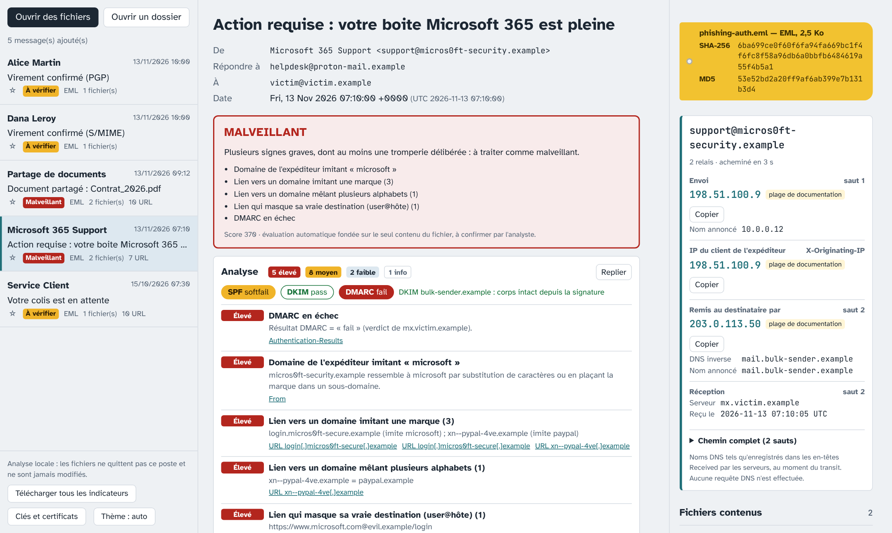
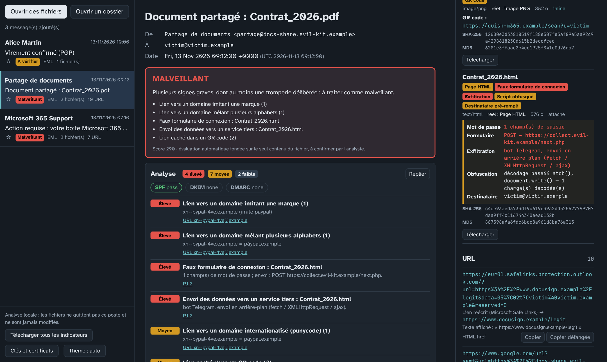

# Email Analysis

**Déposez un courriel suspect. En une seconde : un verdict, les preuves qui le fondent, et tout ce qu'il faut pour agir.**

Email Analysis est un outil d'investigation forensic pour les fichiers **`.eml`** et **`.msg`** (Outlook),
et pour les boîtes Outlook **`.pst`** / **`.ost`** dans l'application de bureau.
Il lit le message comme un analyste le ferait — d'où il vient vraiment, qui l'a signé, où mènent
ses liens, ce que cachent ses pièces jointes — et le restitue dans une interface claire, un rapport
imprimable et des indicateurs prêts à bloquer.

Tout se passe **sur votre poste**. Aucun fichier n'est envoyé, aucune requête n'est émise, et la
preuve n'est jamais modifiée.



> **Essayer tout de suite** : la version web tourne entièrement dans le navigateur —
> [tranosgames.github.io/email_analysis](https://tranosgames.github.io/email_analysis/).
> Les fichiers que vous y déposez ne quittent pas votre machine.

---

## Ce qu'il voit pour vous

### Un verdict, et pourquoi

Chaque message reçoit un verdict — **Malveillant**, **À vérifier** ou **Légitime** — affiché en tête
et en pastille dans la liste, avec les raisons qui le fondent. Le verdict est prudent par construction :

- « Malveillant » exige un **signe de tromperie délibérée** (domaine sosie, exécutable déguisé, lien
  masqué…) : un expéditeur simplement mal configuré n'est pas accusé à tort ;
- « Légitime » exige une **preuve d'authenticité** (DMARC, SPF + DKIM, ou une signature PGP / S/MIME
  vérifiée) : sans elle, le message reste « À vérifier ».

### Qui a vraiment envoyé ce message

- **Acheminement** : IP et nom de la machine d'envoi, IP du client de l'expéditeur, serveur qui a
  remis le message, chemin complet relais par relais avec les délais — lus dans les en-têtes, sans
  aucune requête DNS.
- **SPF, DKIM, DMARC** : le verdict qui fait foi, et l'empreinte du corps DKIM **recalculée** : un
  message retouché après signature est démasqué.
- **Signatures PGP et S/MIME** vérifiées sur les octets exacts : valide, falsifiée, clé inconnue,
  certificat expiré, signataire différent de l'expéditeur. Importez vos clés et autorités une fois,
  elles restent sur le poste.
- **Usurpation** : domaine sosie d'une marque, Reply-To ou Return-Path d'un autre domaine, nom
  affiché trompeur, date dans le futur, relais qui remontent le temps.

### Où mènent les liens

- Toutes les URL du message, dédoublonnées et localisées (en-tête, texte, `href`, CSS), **jamais
  cliquables**, copiables brutes ou défangées.
- **Liens trompeurs** : texte affiché ≠ destination, `user@hôte`, adresse IP brute, punycode et
  alphabets mélangés (`pаypal` avec un « а » cyrillique est démasqué).
- **Redirections décodées sans cliquer** : Safe Links, Proofpoint, Google, Bing, Facebook, YouTube,
  LinkedIn… La vraie destination est extraite et analysée à son tour.
- **QR codes** : les images du message sont scannées, l'URL cachée dans un QR code (« quishing »)
  rejoint la liste.

### Ce que cachent les pièces jointes

- **Type réel** reconnu au contenu (exécutable, raccourci, ISO, archive, document Office…) et comparé
  à l'extension : double extension, caractères d'inversion Unicode, macros, archives chiffrées.
- **Pages HTML jointes** lues sans être exécutées : faux formulaire de connexion et adresse où partent
  les identifiants, exfiltration (bot Telegram, webhooks…), code obfusqué décodé, redirection
  automatique, adresse de la victime pré-remplie.
- Empreintes SHA-256 et MD5, messages joints ouverts en cascade, et **téléchargement sous
  confirmation**, identique octet pour octet.

### Une lecture sans risque

- Le corps HTML est affiché **neutralisé** : scripts retirés, pixels de suivi et images distantes
  bloqués. Chaque ressource bloquée est listée et localisée, dans le rendu comme dans la source.
- Les messages Outlook dont la mise en forme n'existe qu'en RTF retrouvent leur HTML d'origine.
- Tous les en-têtes bruts d'un clic (touche `H`), thème clair ou sombre, plein écran.

### Les boîtes Outlook entières

Déposez un `.pst` ou un `.ost` : l'arborescence s'affiche aussitôt, avec le nombre d'éléments de
chaque dossier. Rien d'autre n'est lu. Ouvrez un dossier : ses lignes viennent de la table du
dossier, sans ouvrir un seul message. **Seul le message sur lequel vous cliquez est lu et analysé**,
avec exactement la même analyse qu'un `.eml` — verdict, acheminement, liens, pièces jointes,
signatures — et un fil d'Ariane qui donne sa provenance (boîte › dossier › élément).

L'empreinte SHA-256 / MD5 de la boîte se calcule en arrière-plan par petits pas ; elle est reportée
sur chaque rapport. La boîte est ouverte en lecture seule et jamais chargée en entière en mémoire :
une boîte de plusieurs gigaoctets s'ouvre en quelques millisecondes. PST Unicode et ANSI, OST
Outlook 2013 et plus récents. Les contacts, rendez-vous et tâches s'affichent sans verdict.


### Restituer

- **Indicateurs** (adresses, domaines, IP publiques, URL, empreintes) dédoublonnés et défangés :
  copie en un clic, export CSV ou JSON, pour un message ou pour tous.
- **Rapport** autonome : HTML imprimable en PDF (sans aucune ressource externe) ou JSON versionné.
  Preuve et empreintes, verdict, constats, signatures, authentification, acheminement, pièces
  jointes, URL et indicateurs, annexe des en-têtes.



---

## Les principes

| | |
|---|---|
| **La preuve est intouchable** | Les fichiers sont ouverts en lecture seule ; leur SHA-256 et MD5 sont calculés à l'ouverture et figurent dans chaque rapport. L'outil refuse d'écrire dans le dossier d'une preuve. |
| **Rien ne sort** | Aucune requête réseau, aucune résolution DNS, aucune réputation en ligne. Les seuls liens externes (vérification d'une clé PGP) ne s'ouvrent que sur clic confirmé. |
| **Le contenu est hostile** | HTML neutralisé, ressources distantes bloquées, URL non cliquables, pièces jointes jamais exécutées, mémoire bornée sur les fichiers piégés. |
| **Vérifiable** | Le même moteur sert la ligne de commande, l'application et la page web ; chaque version est testée sur un corpus de messages réels et piégés. |

---

## Trois façons de l'utiliser

### Dans le navigateur

Aucune installation : ouvrez la page, déposez vos fichiers. Le moteur est compilé en WebAssembly et
s'exécute dans un processus isolé de la page ; une politique de sécurité stricte interdit toute
connexion après le chargement. Une fois ouverte, la page continue de fonctionner hors-ligne.

### Application de bureau

Windows, macOS et Linux. Glisser-déposer de fichiers ou de dossiers entiers, ouverture directe
depuis l'explorateur.

```console
cd apps/desktop
npm install
npm run tauri dev       # lancer en développement
npm run tauri build     # produire les installeurs (.msi, .dmg, .deb, .AppImage)
```

Prérequis : Rust stable et Node.js 20+. Sous Linux : `libwebkit2gtk-4.1-dev libsoup-3.0-dev librsvg2-dev`.

### Ligne de commande

Pour l'automatisation, le traitement par lots et la contre-vérification. Le binaire `mf` est produit dans `target/release/`.

```console
cargo build --release
mf show suspect.eml --headers                    # résumé, en-têtes, fichiers, URL
mf findings *.eml *.msg                          # verdict, authentification, constats
mf urls suspect.msg --defang                     # URL défangées
mf attachments suspect.msg                       # arborescence des pièces et messages joints
mf extract suspect.eml --index 1 --out ./pj      # extraire une pièce jointe
mf iocs *.eml --format csv --defang > iocs.csv   # indicateurs de tout un lot
mf report suspect.eml --out rapport.html         # rapport (ou --format json)
mf show signe.eml --keys ./cles/                 # vérifier PGP / S/MIME avec vos clés
```

Les boîtes Outlook ont leurs propres commandes, qui ne lisent que ce qu'on leur demande :

```console
mf pst info boite.pst                            # format, dossiers, éléments, empreinte
mf pst tree boite.pst                            # arborescence avec compteurs
mf pst ls boite.pst --folder "Inbox"             # lignes d'un dossier (table du dossier)
mf pst show boite.pst --id 2097220 --headers     # lire et analyser un seul élément
mf pst report boite.pst --id 2097220 --out r.html
```

Toutes les commandes acceptent `--json`.

### Raccourcis clavier

| Touche | Action |
|---|---|
| `↑` `↓` | message précédent / suivant |
| `H` | afficher / masquer les en-têtes |
| `P` | épingler le message |
| `Échap` | revenir au message parent |

---

## Sous le capot

Un moteur unique en **Rust**, sans aucun code `unsafe`, partagé par les trois interfaces.

```text
crates/
├── mf-core       modèle de données, lecture des preuves, empreintes
├── mf-eml        format MIME (.eml)
├── mf-msg        format Outlook (.msg) : conteneur OLE, propriétés MAPI, RTF compressé
├── mf-analysis   acheminement, SPF/DKIM/DMARC, liens, pièces jointes, QR codes, constats, verdict
├── mf-sig        signatures PGP et S/MIME
├── mf-pst        boîtes .pst / .ost : lecture paginée, arborescence, éléments à la demande
├── mf-report     rapports HTML et JSON, export des indicateurs
├── mf-engine     point d'entrée commun
├── mf-cli        ligne de commande « mf »
└── mf-wasm       moteur compilé pour le navigateur
apps/desktop/     interface TypeScript commune : application Tauri 2 et version web
vendor/           lecteur PST de Microsoft (MIT), audité et passé en lecture seule
tests/corpus/     messages de référence, réels et synthétiques (phishing, quishing, signés…)
specs/            spécifications, plan et tâches du projet
```

### Développer

```console
cargo test --workspace --exclude mailforensics-desktop   # tests unitaires et corpus
cargo clippy --workspace --all-targets -- -D warnings

cd apps/desktop
npm run dev:web      # version web sur http://localhost:5173
npm run build:web    # page statique dans dist-web/
npm run test:web     # tests de bout en bout dans un vrai navigateur
npm run test:box     # interface des boîtes PST, avec un pont simulé
```

La version web demande en plus la cible `wasm32-unknown-unknown` et `wasm-bindgen-cli` 0.2.129.
Chaque poussée sur `main` publie la page web.

Le projet est piloté par ses spécifications : chaque fonctionnalité part d'une exigence numérotée
dans `specs/`, puis d'un plan et de tâches cochées au fil de l'implémentation.

---

## Et ensuite

- **Boîtes Outlook, suite** : filtres sur les colonnes des dossiers, ouverture dans la version web,
  export des éléments analysés.
- **Listes de l'équipe** : domaines légitimes de l'organisation, listes de blocage importées,
  règles maison prises en compte par le verdict.
- Contenu des archives et des documents Office.

---

## Licence

Apache-2.0 — voir [`LICENSE`](LICENSE). Une partie des messages `.msg` du corpus de test provient de
projets sous licence MIT, crédités dans [`tests/corpus/README.md`](tests/corpus/README.md).
